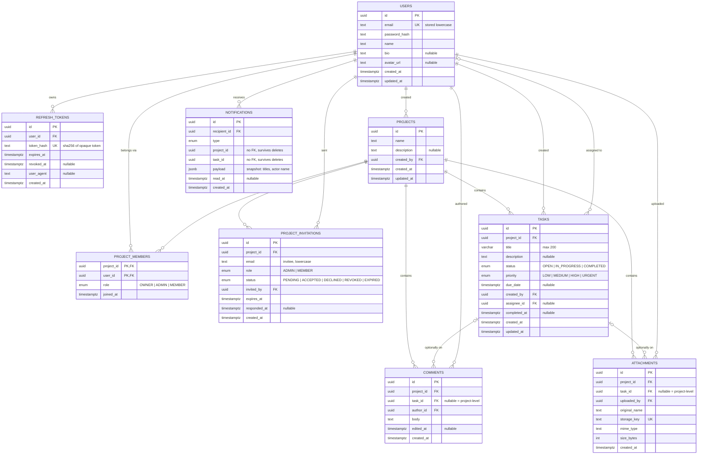

# TaskMaster

[](https://github.com/utkarsh-vats/Airtribe_TaskMaster/actions/workflows/ci.yml)

A collaborative task-tracking REST API. Users create projects, invite teammates, and work on tasks together through assignments, comments and attachments.

**Stack:** Node.js 22, TypeScript, Express 5, PostgreSQL 18, Prisma 6, Zod, Vitest

All required user stories are implemented, plus the optional live notifications (SSE) and AI task descriptions. Full design: [docs/DESIGN.md](docs/DESIGN.md).

## User stories

All paths are under `/api/v1`.

| #   | User story                                           | Implemented by                                                                                                                       |
| --- | ---------------------------------------------------- | ------------------------------------------------------------------------------------------------------------------------------------ |
| 1   | Create an account                                    | `POST /auth/register`                                                                                                                |
| 2   | Log in                                               | `POST /auth/login` (and `POST /auth/refresh` to stay logged in)                                                                      |
| 3   | View and update my profile                           | `GET /users/me`, `PATCH /users/me`, `PATCH /users/me/password`                                                                       |
| 4   | Create a task with a title, description and due date | `POST /projects/:projectId/tasks`                                                                                                    |
| 5   | View the tasks assigned to me                        | `GET /users/me/tasks` (all my projects), `GET /projects/:projectId/tasks?assignee=me`                                                |
| 6   | Mark a task as completed                             | `PATCH /projects/:projectId/tasks/:taskId` with `{ "status": "COMPLETED" }`                                                          |
| 7   | Assign a task to a team member                       | `assigneeId` on `POST /projects/:projectId/tasks` or `PATCH /projects/:projectId/tasks/:taskId`                                      |
| 8   | Filter tasks by status                               | `GET /projects/:projectId/tasks?status=OPEN,IN_PROGRESS` (also on `/users/me/tasks`)                                                 |
| 9   | Search tasks by title or description                 | `GET /projects/:projectId/tasks?q=…` (also on `/users/me/tasks`)                                                                     |
| 10  | Comment on tasks and attach files                    | `/projects/:projectId/comments` and `/projects/:projectId/attachments` (with `taskId`, or project-level without)                     |
| 11  | Create a team (project) and invite members           | `POST /projects`, `POST /projects/:projectId/invitations`, `GET /users/me/invitations`, `POST /invitations/:invitationId/accept`     |
| 12  | Log out                                              | `POST /auth/logout` (this session), `POST /auth/logout-all` (every session)                                                          |
| 13  | Notifications (optional)                             | `GET /notifications`, `GET /notifications/stream` (SSE), `PATCH /notifications/:notificationId/read`, `POST /notifications/read-all` |
| 14  | AI-generated task descriptions (optional)            | `POST /ai/task-description`                                                                                                          |

## Architecture

Each request flows **routes → middleware → controller → service → repository**. Middleware handles cross-cutting checks: `authenticate` (bearer token), `validate` (Zod schemas for body, params and query), and on project routes `loadMembership` (non-members get 404) and `requireRole` (403 below the required role). Controllers only translate HTTP; services hold business rules, permission checks and transactions; repositories are the only layer that talks to the database (Prisma). Each feature is a module under `src/modules/` (auth, users, projects, members, tasks, comments, attachments, notifications, ai).



## Prerequisites

- Node.js 20 or newer (22 recommended)
- Docker (for PostgreSQL)

## Setup

```bash
cp .env.example .env          # set POSTGRES_PASSWORD and JWT_ACCESS_SECRET
cp .env.test.example .env.test   # test database config
docker compose up -d          # Postgres 18.3 on localhost:5434, with `taskmaster` and `taskmaster_test` databases
npm install                   # also runs `prisma generate`
npm run db:migrate            # apply migrations to the dev database
npm run db:seed               # optional demo data (alice@example.com / bob@example.com, Password123!)
npm run dev                   # http://localhost:3000/health
```

## Tests

Tests run against a real PostgreSQL database (`taskmaster_test`, created by the Compose init script) configured in `.env.test`; credentials not set there come from `.env`. `resetDb()` refuses to run against any database whose name doesn't end in `_test`.

```bash
npm run test:db               # apply migrations to the test database (after any new migration)
npm test
```

Set `LOG_LEVEL=error` to see server errors while running tests (e.g. `$env:LOG_LEVEL='error'; npm test` in PowerShell).

Tests are silent by default only while `LOG_LEVEL` is unset, so keep it out of `.env` (it defaults to `info` for the dev server anyway). Under `NODE_ENV=test`, passwords are hashed with the cheapest argon2id parameters the library allows to keep the suite fast; other environments use the library defaults.

## API

Base path `/api/v1`. Endpoints:

Interactive docs: http://localhost:3000/docs (raw spec at /openapi.json). The spec can also be imported into Postman.

| Method | Path                                                             | Auth                        | Body                                                                      | Success                                                                                                                 |
| ------ | ---------------------------------------------------------------- | --------------------------- | ------------------------------------------------------------------------- | ----------------------------------------------------------------------------------------------------------------------- |
| GET    | `/health` (no base path)                                         | —                           | —                                                                         | 200 `{ data: { status, db } }` (503 if the database is down)                                                            |
| POST   | `/api/v1/auth/register`                                          | —                           | `{ email, password, name }`                                               | 201 user                                                                                                                |
| POST   | `/api/v1/auth/login`                                             | —                           | `{ email, password }`                                                     | 200 `{ accessToken, refreshToken, expiresIn, tokenType, user }`                                                         |
| POST   | `/api/v1/auth/refresh`                                           | —                           | `{ refreshToken }`                                                        | 200 new `{ accessToken, refreshToken, expiresIn, tokenType }`                                                           |
| POST   | `/api/v1/auth/logout`                                            | —                           | `{ refreshToken }`                                                        | 204                                                                                                                     |
| POST   | `/api/v1/auth/logout-all`                                        | Bearer                      | —                                                                         | 204                                                                                                                     |
| GET    | `/api/v1/users/me`                                               | Bearer                      | —                                                                         | 200 user                                                                                                                |
| PATCH  | `/api/v1/users/me`                                               | Bearer                      | `{ name?, bio?, avatarUrl? }` (at least one; `null` clears bio/avatarUrl) | 200 user                                                                                                                |
| PATCH  | `/api/v1/users/me/password`                                      | Bearer                      | `{ currentPassword, newPassword }`                                        | 204; signs out every session                                                                                            |
| GET    | `/api/v1/users/me/invitations`                                   | Bearer                      | —                                                                         | 200 my pending, unexpired invitations, with `project` and `invitedBy`                                                   |
| GET    | `/api/v1/users/me/tasks`                                         | Bearer                      | —                                                                         | 200 tasks assigned to me across my projects, with `project { id, name }`; same query as the task list except `assignee` |
| POST   | `/api/v1/projects`                                               | Bearer                      | `{ name, description? }`                                                  | 201 project; caller becomes OWNER                                                                                       |
| GET    | `/api/v1/projects?page=&limit=`                                  | Bearer                      | —                                                                         | 200 my projects, most recently updated first, paginated                                                                 |
| GET    | `/api/v1/projects/:projectId`                                    | member                      | —                                                                         | 200 project                                                                                                             |
| PATCH  | `/api/v1/projects/:projectId`                                    | ADMIN+                      | `{ name?, description? }` (at least one)                                  | 200 project                                                                                                             |
| DELETE | `/api/v1/projects/:projectId`                                    | OWNER                       | —                                                                         | 204; deletes its members, tasks, comments and attachments                                                               |
| GET    | `/api/v1/projects/:projectId/members`                            | member                      | —                                                                         | 200 members: OWNER, ADMINs, MEMBERs, each by join date                                                                  |
| PATCH  | `/api/v1/projects/:projectId/members/:userId`                    | OWNER                       | `{ role }`; `OWNER` transfers ownership                                   | 200 updated member list                                                                                                 |
| DELETE | `/api/v1/projects/:projectId/members/:userId`                    | member (self) / ADMIN+      | —                                                                         | 204; leave or remove; their open tasks are unassigned                                                                   |
| POST   | `/api/v1/projects/:projectId/invitations`                        | ADMIN+                      | `{ email, role? }` (`MEMBER` default; `ADMIN` needs OWNER)                | 201 invitation, expires in 7 days                                                                                       |
| GET    | `/api/v1/projects/:projectId/invitations?status=&page=&limit=`   | ADMIN+                      | —                                                                         | 200 invitations, newest first, paginated                                                                                |
| DELETE | `/api/v1/projects/:projectId/invitations/:invitationId`          | ADMIN+                      | —                                                                         | 204; revokes a pending invitation                                                                                       |
| POST   | `/api/v1/invitations/:invitationId/accept`                       | invitee                     | —                                                                         | 200 `{ projectId, role }`; you become a member                                                                          |
| POST   | `/api/v1/invitations/:invitationId/decline`                      | invitee                     | —                                                                         | 204                                                                                                                     |
| POST   | `/api/v1/projects/:projectId/tasks`                              | member                      | `{ title, description?, dueDate?, priority?, assigneeId? }`               | 201 task; starts `OPEN`, priority `MEDIUM` by default                                                                   |
| GET    | `/api/v1/projects/:projectId/tasks`                              | member                      | —                                                                         | 200 tasks, filtered, sorted and paginated (see below)                                                                   |
| GET    | `/api/v1/projects/:projectId/tasks/:taskId`                      | member                      | —                                                                         | 200 task with `assignee`, `createdBy`, `commentCount`, `attachmentCount`                                                |
| PATCH  | `/api/v1/projects/:projectId/tasks/:taskId`                      | creator, assignee or ADMIN+ | any of `title, description, dueDate, priority, status, assigneeId`        | 200 task; `{ "status": "COMPLETED" }` completes it                                                                      |
| DELETE | `/api/v1/projects/:projectId/tasks/:taskId`                      | creator or ADMIN+           | —                                                                         | 204; deletes its comments and attachments                                                                               |
| POST   | `/api/v1/projects/:projectId/comments`                           | member                      | `{ body, taskId? }` (no `taskId` = project-level comment)                 | 201 comment with `author { id, name }`                                                                                  |
| GET    | `/api/v1/projects/:projectId/comments?taskId=&page=&limit=`      | member                      | —                                                                         | 200 comments, oldest first, paginated; `taskId=<uuid>` for one task, `taskId=none` for project-level only               |
| GET    | `/api/v1/projects/:projectId/comments/:commentId`                | member                      | —                                                                         | 200 comment with `author`, `task` and `project` summaries                                                               |
| PATCH  | `/api/v1/projects/:projectId/comments/:commentId`                | author                      | `{ body }`                                                                | 200 comment; sets `editedAt`                                                                                            |
| DELETE | `/api/v1/projects/:projectId/comments/:commentId`                | author or ADMIN+            | —                                                                         | 204                                                                                                                     |
| POST   | `/api/v1/projects/:projectId/attachments`                        | member                      | `multipart/form-data`: `file`, optional `taskId`                          | 201 `{ id, originalName, mimeType, sizeBytes, taskId, createdAt, uploadedBy }`                                          |
| GET    | `/api/v1/projects/:projectId/attachments?taskId=&page=&limit=`   | member                      | —                                                                         | 200 attachment metadata, newest first, paginated; `taskId` as for comments                                              |
| GET    | `/api/v1/projects/:projectId/attachments/:attachmentId`          | member                      | —                                                                         | 200 attachment metadata                                                                                                 |
| GET    | `/api/v1/projects/:projectId/attachments/:attachmentId/download` | member                      | —                                                                         | 200 the file, as a download with its original name                                                                      |
| DELETE | `/api/v1/projects/:projectId/attachments/:attachmentId`          | uploader or ADMIN+          | —                                                                         | 204; the stored file is removed too                                                                                     |
| GET    | `/api/v1/notifications?unread=&page=&limit=`                     | Bearer                      | —                                                                         | 200 my notifications, newest first, paginated; `meta.unreadCount`                                                       |
| GET    | `/api/v1/notifications/stream`                                   | Bearer                      | —                                                                         | 200 `text/event-stream` of new notifications (see below)                                                                |
| PATCH  | `/api/v1/notifications/:notificationId/read`                     | Bearer                      | —                                                                         | 204; idempotent                                                                                                         |
| POST   | `/api/v1/notifications/read-all`                                 | Bearer                      | —                                                                         | 204                                                                                                                     |
| POST   | `/api/v1/ai/task-description`                                    | Bearer                      | `{ title, notes? }`                                                       | 200 `{ description }` suggested for a new task (nothing is saved); 503 if AI isn't configured                           |

A project in a response has `id, name, description, createdAt, updatedAt, myRole, memberCount`; single-project responses add `owner: { id, name, email }`. Pagination: `page` ≥ 1 (default 1), `limit` 1–100 (default 20).

Dates are ISO 8601 with an offset (`2026-10-25T17:00:00Z` or `…+05:30`). `assigneeId` must be a member of the project (422 otherwise); `null` unassigns.

#### Task list query

`GET /projects/:projectId/tasks` and `GET /users/me/tasks` take the same query parameters (`/users/me/tasks` rejects `assignee`). Unknown parameters and invalid values return 422.

| Param                   | Example                        | Meaning                                                                                            |
| ----------------------- | ------------------------------ | -------------------------------------------------------------------------------------------------- |
| `status`                | `OPEN,IN_PROGRESS`             | comma list of `OPEN`, `IN_PROGRESS`, `COMPLETED`                                                   |
| `priority`              | `HIGH,URGENT`                  | comma list of `LOW`, `MEDIUM`, `HIGH`, `URGENT`                                                    |
| `assignee`              | `me` / `unassigned` / `<uuid>` |                                                                                                    |
| `createdBy`             | `me` / `<uuid>`                |                                                                                                    |
| `dueBefore`, `dueAfter` | `2026-10-25T00:00:00Z`         | due strictly before / after                                                                        |
| `overdue`               | `true` / `false`               | `true`: past due and not completed; `false`: everything else                                       |
| `q`                     | `login bug`                    | case-insensitive match in title or description                                                     |
| `sort`                  | `dueDate`                      | `dueDate`, `createdAt` (default), `updatedAt`, `priority`, `title`                                 |
| `order`                 | `asc` / `desc`                 | defaults: `dueDate` asc, `createdAt`/`updatedAt` desc, `priority` desc (URGENT first), `title` asc |
| `page`, `limit`         | `1`, `20`                      | `limit` max 100                                                                                    |

Tasks without a due date always sort last. Example: `GET /api/v1/projects/:projectId/tasks?status=OPEN,IN_PROGRESS&assignee=me&sort=dueDate`.

Comment `body` is trimmed, 1–5000 characters. A `taskId` that isn't in the project returns 404, both when posting and when filtering.

Attachments: one file per upload, in the form field `file`, up to `MAX_UPLOAD_MB` (10 MB; over → 413). Allowed types: PNG, JPEG, GIF, WebP, PDF, plain text, CSV, zip, Word and Excel (anything else → 415). The type is the one the client declares; the file contents aren't inspected. The original filename is kept for display and downloads only; files are stored under random server-generated names.

The full API is in [DESIGN.md §7](docs/DESIGN.md#7-api).

### Permissions

Every project has exactly one OWNER; other members are ADMIN or MEMBER. Anyone who isn't a member gets **404** for the project and everything under it, so its existence isn't leaked. A member whose role is too low gets **403**. The full matrix is in [DESIGN.md §5](docs/DESIGN.md#5-roles-and-permissions).

- **Roles:** only the OWNER changes roles, and nobody can change their own (409). Setting someone's role to `OWNER` transfers ownership: the current owner becomes ADMIN in the same transaction.
- **Leaving and removal:** any member can leave except the OWNER, who must transfer ownership first (409). ADMINs can remove MEMBERs; the OWNER can remove ADMINs and MEMBERs. A removed or departing member's open tasks are unassigned; completed tasks, comments and attachments stay.
- **Tasks:** any member can create tasks and read everything in the project. A task can be updated by its creator, its assignee or an ADMIN+, and deleted by its creator or an ADMIN+. Completing a task records `completedAt`; reopening clears it.
- **Comments:** any member can comment on the project or on one of its tasks, and read all comments. Only the author can edit a comment (not even the OWNER); the author or an ADMIN+ can delete it. Deleting a task deletes its comments.
- **Attachments:** any member can upload to the project or one of its tasks, list and download. The uploader or an ADMIN+ can delete an attachment. Deleting a task or project also deletes its attachments' files.
- **Invitations** go to an email address, so the invitee doesn't need an account yet: they see the invite under `/users/me/invitations` once registered with that email. ADMINs can invite MEMBERs; only the OWNER can invite ADMINs. One pending invitation per email per project (409 otherwise), and none for existing members (409).
- **Expiry** is checked when used: a pending invitation past its expiry date shows as `EXPIRED` in lists and filters, and accepting or declining it returns 410 `INVITATION_EXPIRED`. Accepting someone else's invitation returns 404, so its existence isn't revealed.

### Responses and errors

Success bodies are `{ "data": ... }`, plus `"meta": { page, limit, total, totalPages }` on paginated lists. Errors always look like this:

```json
{
  "error": {
    "code": "VALIDATION_ERROR",
    "message": "Request validation failed",
    "details": [{ "path": "email", "message": "Invalid email address" }],
    "requestId": "..."
  }
}
```

| HTTP | `code`                                                                                                                          |
| ---- | ------------------------------------------------------------------------------------------------------------------------------- |
| 400  | `BAD_REQUEST` (malformed JSON or multipart body, a second file, or a file field not named `file`)                               |
| 400  | `INVALID_CURRENT_PASSWORD` (change password; not 401, so clients don't try a token refresh)                                     |
| 401  | `UNAUTHORIZED`, `INVALID_CREDENTIALS`, `TOKEN_EXPIRED`, `INVALID_REFRESH_TOKEN`                                                 |
| 403  | `FORBIDDEN` (project member without the required role)                                                                          |
| 404  | `NOT_FOUND` (also for projects you're not a member of)                                                                          |
| 409  | `CONFLICT` (e.g. email already registered, already a member, invitation no longer pending, task status changed by someone else) |
| 410  | `INVITATION_EXPIRED` (accepting or declining an expired invitation)                                                             |
| 413  | `PAYLOAD_TOO_LARGE` (upload over `MAX_UPLOAD_MB`, or a JSON body over 1 MB)                                                     |
| 415  | `UNSUPPORTED_MEDIA_TYPE` (upload type not in the allowlist)                                                                     |
| 422  | `VALIDATION_ERROR` (body, params or query failed validation; unknown fields too)                                                |
| 429  | `RATE_LIMITED`                                                                                                                  |
| 500  | `INTERNAL_ERROR` (no stack traces are ever sent)                                                                                |
| 502  | `AI_UPSTREAM_ERROR` (the AI provider failed or took longer than 10 s)                                                           |
| 503  | `AI_DISABLED` (no AI provider configured)                                                                                       |

Every response carries an `X-Request-Id` header (an incoming one is reused), matching `requestId` in errors and the logs.

### Postman collection

[`Airtribe_TaskMaster.postman_collection.json`](Airtribe_TaskMaster.postman_collection.json) has a request for every endpoint above (46 requests in folders: Auth, Users, Projects with Members and Invitations, Tasks, Comments and Attachments, Invitations, Notifications, AI, plus `health`). Import it into Postman; it uses collection variables, with `base_url` defaulting to `http://localhost:3000`.

- `Auth_Login` stores `access_token`, `refresh_token` and `user_id1`; every other request sends `Bearer {{access_token}}`.
- Create requests store the new id for the requests after them: `Create_Project` → `project_id1`, `Create_Task` → `task_id1`, `Create_Invitation` → `invitation_id1`, `Create_Comment` → `project_comment_id1`, `Create_Comment_For_Task` → `comment_id1`, `Upload_Attachment` → `project_attachment_id1`, `Upload_Attachment_For_Task` → `task_attachment_id1`, and `Get_Notifications` → `notification_id1` (the newest notification).
- `Generate_Task_Description` calls whichever AI provider `.env` configures (see [Configuration](#configuration)); with none configured it returns 503, and with one it spends real API credit.
- `Notifications_Stream` opens the SSE stream; Postman shows each event as it arrives. Notifications go to the _other_ users involved, so open the stream as one user and act as another.
- The upload requests send form-data with a `file` field. After importing, pick a file from your machine for that field (the saved one lives in the author's Postman workspace).
- A typical run: `Auth_Register` (second user) → `Auth_Login` → `Create_Project` → `Create_Task` → `Create_Invitation` → log in as the invitee → `Accept_Invitation` → the remaining requests.

### Notifications

You get a notification when someone else acts on something that involves you. You're never notified about your own actions.

| What happened                                     | Who is notified          | `type`               |
| ------------------------------------------------- | ------------------------ | -------------------- |
| A task is assigned to you (on create or update)   | the new assignee         | `TASK_ASSIGNED`      |
| A task is completed                               | its creator and assignee | `TASK_COMPLETED`     |
| A task's other fields change                      | its creator and assignee | `TASK_UPDATED`       |
| Someone comments on a task                        | its creator and assignee | `COMMENT_ADDED`      |
| You're invited to a project (and have an account) | you                      | `PROJECT_INVITATION` |

One task update produces one notification type: assignment beats completion, which beats other changes. Project-level comments don't notify anyone. Each notification's `payload` keeps the names as they were at the time (`actor`, `project`, `task`, plus `changedFields`, a comment preview, or the invited role).

**Live updates (SSE):** `GET /api/v1/notifications/stream` keeps the connection open and sends `event: notification` with the notification as JSON whenever a new one is created, plus a `: ping` comment every 25 s. Anything missed while disconnected is in `GET /api/v1/notifications`.

```bash
curl -N -H "Authorization: Bearer <accessToken>" http://localhost:3000/api/v1/notifications/stream
```

The browser's `EventSource` can't send an `Authorization` header, so use a fetch-based SSE reader (or curl) that can. A browser-friendly alternative would be a short-lived, single-use `?token=` ticket issued by an authenticated endpoint; it isn't implemented here.

**Limitation:** open streams are tracked in memory, so live pushes only reach clients connected to the same server instance. Running several instances would need a shared channel such as Redis pub/sub; stored notifications aren't affected.

### AI task descriptions

`POST /api/v1/ai/task-description` with `{ title, notes? }` returns a suggested description: one goal sentence followed by 3–6 acceptance criteria as `- ` bullets, about 150 words at most. It only suggests text; save it by creating or updating the task as usual. Each user can make 10 requests per minute; a provider call that fails or takes over 10 s returns 502 without exposing the provider's error.

## Authentication

- **Passwords** are hashed with argon2id. Emails are trimmed and lowercased before storage and lookup.
- **Access token:** JWT (HS256), 15 minutes by default (`ACCESS_TOKEN_TTL_SECONDS`). Send it as `Authorization: Bearer <token>`. An expired token returns 401 `TOKEN_EXPIRED`, which tells the client to refresh.
- **Refresh token:** 32 random bytes (base64url), 7 days by default (`REFRESH_TOKEN_TTL_DAYS`), sent in the JSON body. Only its SHA-256 hash is stored.
- **Rotation:** every refresh revokes the presented token and returns a new pair. Presenting a token that was already rotated or logged out is treated as theft: **all** of that user's sessions are revoked and the client must log in again. Clients should therefore not retry a refresh request with the same token.
- **Login** returns the same 401 `INVALID_CREDENTIALS` for an unknown email and a wrong password, and runs a dummy argon2 verify for unknown emails so response time doesn't reveal which emails exist.
- **Logout** revokes one refresh token (idempotent); **logout-all** revokes every session for the user.
- **Change password** checks the current password, then updates the hash and revokes every refresh token in one transaction.
- **Rate limit:** `/api/v1/auth/*` allows 10 requests per minute per IP (`RateLimit` headers are sent; 429 `RATE_LIMITED` when exceeded).

**Trade-offs**

- Logout can't revoke an access token that was already issued: it stays valid until it expires (at most 15 minutes). A `jti` denylist is the upgrade path.
- Refresh tokens travel in the JSON body because this is an API-only project. A browser app should receive them in an `httpOnly`, `Secure`, `SameSite` cookie instead so page scripts can't read them.

## Known limitations

- **Logout doesn't end access tokens early:** an access token stays valid until it expires (at most 15 minutes). A `jti` denylist is the upgrade path.
- **Live notifications are single-instance:** SSE streams are tracked in memory, so pushes only reach clients connected to the same server. Several instances would need Redis pub/sub or similar; stored notifications are unaffected.
- **Browsers can't open the SSE stream with `EventSource`,** which can't send the `Authorization` header; use a fetch-based reader. A short-lived `?token=` ticket is the browser-friendly alternative (not implemented).
- **Files are stored on local disk** under `UPLOAD_DIR`, so they live on one server. The storage layer is an interface (`StorageDriver`), so an S3 driver can replace it.
- **Upload types are trusted as declared:** the MIME type is the one the client sends; file contents aren't inspected. Downloads are always served as attachments with `X-Content-Type-Options: nosniff`.
- **No email delivery:** invitations are only visible in the app (`GET /users/me/invitations`) once the invitee has an account with that email.
- **Retrying a token refresh logs you out everywhere:** reusing a refresh token that was already rotated is treated as theft and revokes all sessions, so clients must not retry a refresh with the same token.
- **Assignment vs. removal race:** if a member is removed at the same moment a task is being assigned to them, the task can end up assigned to a non-member; fixing it needs row locking in a transaction.
- **AI suggestions depend on a third-party API:** with no provider configured the endpoint returns 503; a slow or failing provider returns 502 after at most 10 s.

## Configuration

`DATABASE_URL` is assembled from the `POSTGRES_*` variables in `.env` (via dotenv-expand), so the credentials live in one place and Docker Compose reads the same values. Keep `POSTGRES_PASSWORD` URL-safe (letters, digits, `-`, `_`).

Uploaded files are stored on local disk under `UPLOAD_DIR` (default `./uploads`, gitignored), one folder per project. Tests use `./tmp/test-uploads` and delete it afterwards.

**AI provider (optional).** The AI endpoint works with either Anthropic (Claude) or Google Gemini, chosen in `.env`, so you can compare their output and cost by switching config only:

| `AI_PROVIDER` | Get an API key                                                              | `AI_MODEL`                                                                            |
| ------------- | --------------------------------------------------------------------------- | ------------------------------------------------------------------------------------- |
| `anthropic`   | [Anthropic Console](https://console.anthropic.com/settings/keys) → API keys | a Claude model id, e.g. `claude-haiku-5-5` (fast and cheap for short descriptions)    |
| `gemini`      | [Google AI Studio](https://aistudio.google.com/apikey) → Get API key        | a Gemini model id from the [model list](https://ai.google.dev/gemini-api/docs/models) |

Set `AI_PROVIDER`, `AI_API_KEY` and `AI_MODEL` together; the server refuses to start if a provider is set without the other two. Leave `AI_PROVIDER` empty to turn the feature off (503 `AI_DISABLED`). Tests never call a real provider, whatever `.env` says.

## Scripts

| Script                            | What it does                         |
| --------------------------------- | ------------------------------------ |
| `npm run dev`                     | Start with hot reload                |
| `npm run build` / `npm start`     | Compile to `dist/` and run it        |
| `npm run lint` / `npm run format` | ESLint / Prettier                    |
| `npm run format:check`            | Prettier check without writing       |
| `npm run typecheck`               | TypeScript without emitting          |
| `npm run db:migrate`              | Create and apply a migration (dev)   |
| `npm run db:studio`               | Browse the database in Prisma Studio |
| `npm test` / `npm run test:watch` | Run the test suite (once / watch)    |
| `npm run test:db`                 | Apply migrations to the test DB      |
